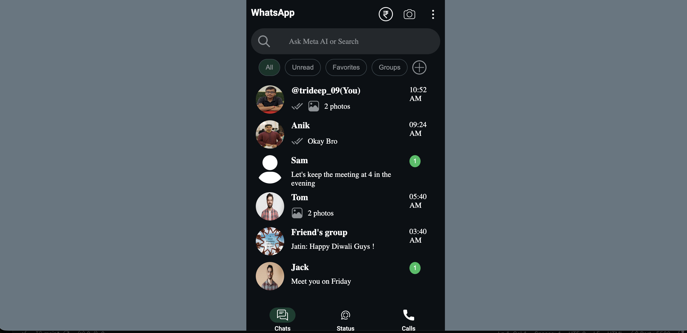
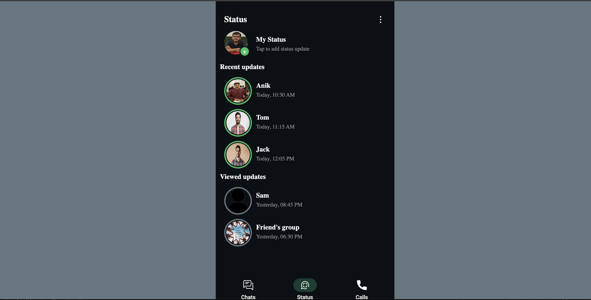
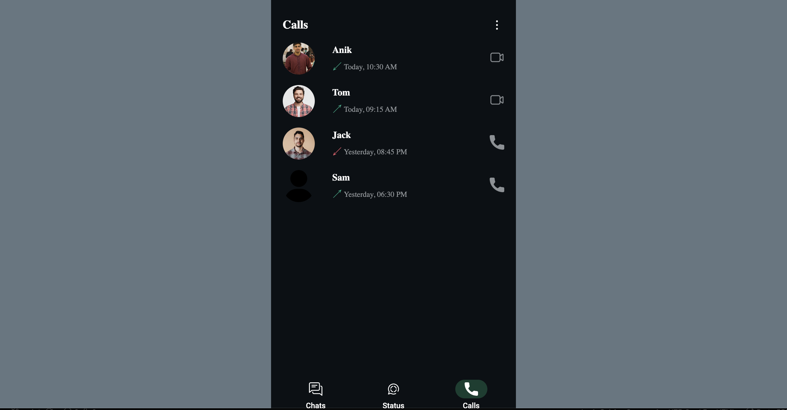

# WhatsApp UI Clone

A mobile-style recreation of the WhatsApp home screen (dark theme) built with **pure HTML and CSS**. No JavaScript, no frameworks, no build tools. Tab switching between **Chats**, **Status**, and **Calls** is handled entirely with CSS.

> **Disclaimer:** This is a personal learning project. It is not affiliated with, endorsed by, or connected to WhatsApp or Meta. All trademarks belong to their respective owners.

---

## Preview


| Chats | Status | Calls |
|:-----:|:------:|:-----:|
|  |  |  |

---

## Features

- **Chats tab**
  - Header with the WhatsApp title and action icons
  - "Ask Meta AI or Search" search bar
  - Filter chips: All, Unread, Favorites, Groups
  - Chat list with profile pictures, last message preview, delivery tick, timestamps, and unread badges
  - Hover highlight on chat rows
- **Status tab**
  - "My Status" entry with an add (+) badge
  - **Recent updates** (green ring) and **Viewed updates** (grey ring) sections
- **Calls tab**
  - Call history with incoming, outgoing, and missed indicators (green and red arrows)
  - Voice and video call icons on each row
- **Bottom navigation** with an active-tab pill highlight
- Dark theme styled after the official app, using the Roboto font

---

## Tech Stack

| Technology | Usage |
|------------|-------|
| HTML5 | Page structure and semantic layout |
| CSS3 | Styling, Flexbox layout, tab logic, hover effects |
| Google Fonts | Roboto typeface |

---

## Project Structure

```
.
├── index.html          # Markup for all three tabs and the bottom nav
├── style.css           # All styling and CSS-only tab switching
├── icons/              # UI icons (PNG)
│   ├── rupee.png
│   ├── camera.png
│   ├── more.png
│   ├── search.png
│   ├── plus.png
│   ├── done.png
│   ├── image.png
│   ├── user.png
│   ├── video.png
│   ├── call.png
│   ├── chat.png
│   └── social-media.png
└── profile-img/        # Contact profile pictures
    ├── ME.png
    ├── ANIK.jpg
    ├── tom.avif
    ├── jack.avif
    └── 2311b10e6409cd824a323041f77984d0.jpg
```

> Make sure the `icons/` and `profile-img/` folders are included in the repository, otherwise images will not load.

---

## Getting Started

No installation is needed.

1. **Clone the repository**
   ```bash
   git clone https://github.com/<your-username>/<your-repo-name>.git
   cd <your-repo-name>
   ```

2. **Open the project**
   - Double-click `index.html`, or
   - Serve it locally, for example with VS Code's *Live Server* extension or:
     ```bash
     python -m http.server 8000
     ```
     then visit `http://localhost:8000`.

3. For the best result, view it in your browser's **mobile device mode** (DevTools → Toggle Device Toolbar). The layout is a fixed 400px-wide container centered on the page.

---

## How It Works

The tabs use the **radio button hack**, with no JavaScript involved:

1. Three hidden radio inputs (`#tab-chats`, `#tab-status`, `#tab-calls`) share the same `name="tab"`.
2. Each bottom-nav `<label>` points to one of those radios via its `for` attribute.
3. CSS sibling selectors show the matching section and highlight the matching nav icon:

```css
.chat-sec, .status-sec, .calls-sec { display: none; }

#tab-chats:checked  ~ .chat-sec   { display: block; }
#tab-status:checked ~ .status-sec { display: block; }
#tab-calls:checked  ~ .calls-sec  { display: block; }
```

---

## Customization

- **Change contacts:** edit the `.chat-line`, `.status-line`, and `.call-line` blocks in `index.html`, and swap the images in `profile-img/`.
- **Change colors:** the main palette lives in `style.css`:

  | Purpose | Color |
  |---------|-------|
  | Page background | `#667781` |
  | App background | `#0b1014` |
  | Search bar / input | `#23282c` |
  | Accent green | `#24bf60` |
  | Active nav pill | `#123e30` |
  | Muted text and icons | `#8f9498` |

- **Change width:** adjust `.container { width: 400px; }` for a different screen size.

---

## Possible Improvements

- Make the layout fully responsive with relative units and media queries
- Add a chat conversation screen
- Add a light theme
- Replace repeated `id="button-notification"` with a class (IDs should be unique)
- Add meaningful `alt` text to images for accessibility
- Add a descriptive `<title>` in place of "Document"


---

## Author

**Trideep Chakraborty**
GitHub: [https://github.com/Trideep091]

